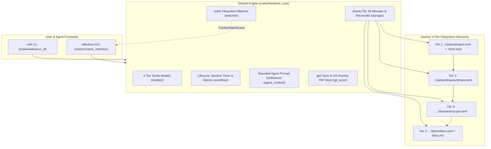

# Nebulous Architecture & 4-Tier `.tracker/` Schema

Nebulous is architected around a strict separation between **fast top-level indexes** (Tiers 1–3) and **authoritative atomic item storage** (Tier 4), backed by a shared Rust library (`backend_core`) consumed by both the `neb` CLI (`nebulous_cli`) and the `nebulous` native desktop GUI (`cosmic_interface`).



---

## 1. Crate Responsibilities

### `crates/backend_core`
The foundational library crate with zero UI dependencies:
- **`models`**: Strongly typed Serde structs and enums for all 4 tiers (`ProjectManifest`, `PhaseManifest`, `ScopeManifest`, `ItemManifest`, `ItemDetail`, `ActiveTimer`) with support for both quoted RFC 3339 strings and unquoted native TOML datetimes.
- **`storage`**:
  - **`atomic`**: Write-to-temp-plus-rename (`<filename>.tmp.<pid>.<counter>`) with file flush (`sync_all`) so `.tracker/` files are never left half-written or corrupted on crash.
  - **`id`**: Monotonic ID allocation (`BUG-0001`, `FEAT-0001`) backed by `[counters]` in `project.toml` plus an on-disk high-water mark scan to prevent ID collisions even if `project.toml` was manually edited.
  - **`reconcile`**: Full tree walker (`TrackerStorage::reconcile_indexes`) that treats Tier 4 `item.toml` manifests as the single source of truth and rebuilds Tier 3 `scope.toml` stubs, Tier 2 `phase.toml` completion summaries, and Tier 1 `project.toml` counters.
- **`workflow`**:
  - **`lifecycle`**: Item creation (`create_item`, `create_bug`, `create_feature`), status transitions (`update_item_status`), closing/merging with commit SHA and fix summary (`close_item`), reopening with automatic `recurrence_count` and `iteration_count` increments (`reopen_item`), and phase/scope creation.
  - **`timer`**: Persistent session timer (`start_timer`, `stop_timer`, `timer_status`, `log_time`) stored in `.tracker/.timer.toml`.
  - **`metrics`**: Project-wide effort valuation (`target_daily_hours`), stagnant item detection (`stagnant_item_threshold_days`), item recurrence hotspots, and scope-level bug hotspot aggregation (`compute_metrics`).
- **`agent_context`**: Synthesizes `@file` reference tags and self-contained **Bounded Agent Prompts** (`export_agent_context`, `export_file_refs`, `export_bounded_prompt`) that constrain AI coding assistants to the scope's target directory and surface all prior fix attempts.
- **`git_sync`**: Native `git2` integration (`stage_and_commit_tracker`, `pull_repo`, `push_repo`, `git_sync`) with automatic merge conflict resolution for derived `.tracker/` index files and Linux Secret Service keyring credential storage (`keyring` service `nebulous-tracker`).
- **`watcher`**: Recursive `notify` filesystem watcher (`TrackerWatcher`) that filters out read-only events and atomic `.tmp.` sibling files, suppresses 300ms self-reconcile echoes, reconciles `.tracker/` indexes on external changes, and streams `TrackerWatchEvent`s to subscribers.

### `crates/nebulous_cli` (`neb` binary)
A `clap`-powered command-line interface designed for both interactive developer use and scripted AI agent tool calls:
- Supports global `--root <PATH>` workspace discovery and `--json` structured output across every subcommand.
- Integrates with the system clipboard via `arboard` (`neb context <ID> --copy`).

### `crates/cosmic_interface` (`nebulous` binary)
A native Linux desktop GUI built on System76's `libcosmic` (`cosmic::Application`):
- **Index-Only Startup**: `NebulousApp::new_from_storage` calls `storage.load_index()` to load only Tier 1–3 manifests. `lazy_detail_loads_count` remains strictly `0` at startup.
- **On-Demand Lazy Loading**: Clicking a card dispatches `Message::SelectCard(id)`, invoking `select_card_and_lazy_load` to read `item.toml` and `desc.md` into the right-hand Context Drawer.
- **Reactive Subscriptions**: Background `Subscription::run_with_id` streams `TrackerWatcher` filesystem events (`Message::TrackerFilesChanged`), a 30-second active timer ticker (`Message::TimerTick`), and optional scheduled Git sync ticks (`Message::ScheduledGitSyncTick`).
- **Headless Self-Test (`--self-test`)**: Exercises workspace initialization, index-only startup assertions, card selection, filter pills, view switching (`Board`, `Metrics`, `PhasesAndScopes`, `Settings`), and widget tree construction in memory without requiring a Wayland or X11 display server.

---

## 2. The 4-Tier `.tracker/` Directory Hierarchy

```text
<workspace_root>/
└── .tracker/
    ├── project.toml                                      # Tier 1: Global project manifest & counters
    ├── .timer.toml                                       # Ephemeral active session timer (when running)
    └── phases/
        └── 01_core_engine/
            ├── phase.toml                                # Tier 2: Phase manifest & scope registry
            └── domains/
                ├── inbox/
                │   ├── scope.toml                        # Tier 3: Default unscoped triage inbox
                │   └── items/
                └── backend_core/
                    ├── scope.toml                        # Tier 3: Domain scope manifest & item stubs
                    └── items/
                        ├── BUG-0001/
                        │   ├── item.toml                 # Tier 4: Authoritative item metadata & history
                        │   └── desc.md                   # Tier 4: Markdown specification & notes
                        └── FEAT-0001/
                            ├── item.toml
                            └── desc.md
```

---

## 3. File Schemas

### Tier 1: `.tracker/project.toml` (`ProjectManifest`)

Controls project-level settings, monotonic ID counters, phase registration, effort/stagnation thresholds, and Git synchronization settings.

```toml
[project]
name = "Nebulous"
version = "0.1.0"
active_phase = "01_core_engine"
default_scope = "inbox"
created_at = "2026-11-01T21:00:00Z"

[counters]
bug = 1
feature = 4

[phases]
registry = [
    { id = "01_core_engine", title = "Core Engine & Parsing", path = "phases/01_core_engine" },
    { id = "02_cloud_sync",  title = "Cloud & Remote Sync",    path = "phases/02_cloud_sync" },
]

[metrics]
target_daily_hours = 6.0
stagnant_item_threshold_days = 4

[git]
sync_mode = "manual"           # "manual" or "scheduled" (alias: "auto")
sync_interval_minutes = 30
remote = "origin"
branch = "main"
auto_commit_on_close = false
```

### Ephemeral Session Timer: `.tracker/.timer.toml` (`ActiveTimer`)

Present only while a session timer is actively running (`neb timer start <ID>` or via the GUI timer button). Removed automatically when stopped (`neb timer stop`).

```toml
item_id = "BUG-0001"
phase_id = "01_core_engine"
scope_id = "backend_core"
started_at = "2026-11-01T21:00:00Z"
note = "Investigating empty array deserialization edge case"
```

### Tier 2: `.tracker/phases/<phase_id>/phase.toml` (`PhaseManifest`)

Tracks phase lifecycle status (`planned`, `in_progress`, `completed`, `blocked`), registered domain scopes, and roll-up completion counts.

```toml
[phase]
id = "01_core_engine"
title = "Core Engine & Parsing"
status = "in_progress"         # "planned" | "in_progress" | "completed" | "blocked"
start_date = "2026-11-01"
# end_date = "2026-11-15"      # Optional

[scopes]
manifest = [
    { id = "inbox",            type = "inbox",      path = "domains/inbox" },
    { id = "backend_core",     type = "rust_crate", path = "domains/backend_core" },
    { id = "nebulous_cli",     type = "cli_crate",  path = "domains/nebulous_cli" },
    { id = "cosmic_interface", type = "ui_crate",   path = "domains/cosmic_interface" },
]

[summary]
total_items = 5
completed_items = 2
```

### Tier 3: `.tracker/phases/<phase_id>/domains/<scope_id>/scope.toml` (`ScopeManifest`)

Defines the architectural boundary of a domain scope (such as a Rust crate or module directory) and stores lightweight `ItemStub` entries (`id`, `title`, `status`, `severity`) so list views and Kanban boards load without reading Tier 4 files.

```toml
[scope]
id = "backend_core"
target = "crates/backend_core"
tech_stack = ["rust", "serde", "toml"]
description = "Core 4-tier persistence, workflow, and analytics engine"

[items]
bugs = [
    { id = "BUG-0001", title = "TOML deserialization fails on empty array", status = "open", severity = "high" },
]
features = [
    { id = "FEAT-0001", title = "Parallel file-tree walker", status = "in_progress", severity = "medium" },
]
```

### Tier 4: `.../items/<ITEM_ID>/item.toml` (`ItemManifest`) & `desc.md`

`item.toml` is the authoritative record for an individual work item:

```toml
[item]
id = "BUG-0001"
type = "bug"                   # "bug" | "feature"
title = "TOML deserialization fails on empty array"
status = "open"                # "open" | "in_progress" | "pending" | "closed" | "merged"
severity = "high"              # "low" | "medium" | "high" | "critical"
scope_ref = "backend_core"
created_at = "2026-11-01T21:15:00Z"
updated_at = "2026-11-01T21:40:00Z"

[effort]
logged_time_minutes = 45
iteration_count = 2

[history]
recurrence_count = 1
previous_fixes = [
    { date = "2026-11-01", commit = "a4f89c1", summary = "Added default trait fallback" },
]
```

Alongside `item.toml`, `desc.md` holds the human- and agent-readable Markdown specification initialized with standard sections:

```markdown
## Problem Description
Describe the problem or specification for: TOML deserialization fails on empty array

## Reproduction Steps
1. Inspect `crates/backend_core`.
2. Run tests to verify behavior.

## Fix Log & Agent Notes
- Target scope path: `crates/backend_core`
```

---

## 4. Consistency, Reconciliation & Lifecycle Guarantees

1. **Atomic Write-Then-Rename**: Every mutation to `project.toml`, `phase.toml`, `scope.toml`, `item.toml`, `desc.md`, or `.timer.toml` writes to a process-unique sibling temporary file, flushes OS buffers via `File::sync_all()`, and atomically renames over the target path.
2. **Synchronous Parent Index Propagation**: Creating or mutating an item immediately updates its parent `scope.toml` `[items]` stub list and recomputes `phase.toml` `[summary]` (`total_items` and `completed_items`).
3. **Self-Healing Index Reconciliation (`neb sync-index` / `reconcile_indexes`)**: If an external editor, script, or `git merge` modifies or adds `items/*/item.toml` files directly, `reconcile_indexes()` walks the `.tracker/phases/` tree, discovers unindexed phases/scopes/items, prunes orphaned stubs whose `item.toml` was deleted, recalculates phase summaries, and advances `project.toml` monotonic counters to at least the highest existing `BUG-XXXX` / `FEAT-XXXX` number.
4. **Recurrence & Anti-Looping Ledger**:
   - Closing an item (`neb close <ID> -m "..."` or via the GUI Context Drawer) records a `PreviousFix` entry with the date, Git `HEAD` short SHA (or `"uncommitted"`), and summary.
   - Reopening a `closed` or `merged` item (`neb reopen <ID>` or transitioning back to `open`/`in_progress`/`pending`) automatically increments both `history.recurrence_count` and `effort.iteration_count`.
   - Exporting agent context (`neb context <ID>`) embeds a prominent `[!WARNING] REGRESSION & PREVIOUS FIX WARNING` block whenever `recurrence_count > 0` or `previous_fixes` is non-empty.
