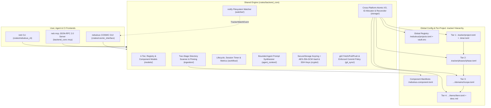

# Nebulous Architecture & 4-Tier `.tracker/` Schema

Nebulous is architected around a strict separation between **fast top-level indexes** (Tiers 1–3) and **authoritative atomic item storage** (Tier 4), backed by a shared cross-platform Rust library (`backend_core`) consumed by the `neb` CLI (`nebulous_cli`), the `neb mcp` JSON-RPC 2.0 server, and the `nebulous` native desktop GUI (`cosmic_interface`).



---

## 1. Crate Responsibilities

### `crates/backend_core`
The foundational library crate with zero UI dependencies:
- **`models`**: Strongly typed Serde structs and enums for all 4 tiers (`ProjectManifest`, `PhaseManifest`, `ScopeManifest`, `ItemManifest`, `ItemDetail`, `ActiveTimer`), plus `GlobalProjectRegistry` (`projects.toml`) and `ComponentManifest` (`nebulous.component.toml`) with support for both quoted RFC 3339 strings and unquoted native TOML datetimes.
- **`crypto`**:
  - **`SecureStorage`**: Cross-platform secret storage using native OS keyrings (`linux-native` Secret Service, `apple-native` Keychain, `windows-native` Credential Manager) paired with an authenticated **AES-256-GCM encrypted file vault fallback** (`<config_dir>/nebulous/vault.enc`, `0600` Unix permissions, `Zeroize` memory scrubbing) so headless CI runners and containers never lose credentials.
  - **`KeyPairManager`**: Generates, imports, retrieves, and deletes Ed25519 OpenSSH keypairs (`ssh-key`) and HTTPS Personal Access Tokens (PATs) per project/remote.
- **`ingestion`**:
  - **Two-Stage Directory Scanner**: Walks project directories using `ignore::WalkBuilder` (respecting `.gitignore` and skipping `.git/`, `.tracker/`, `target/`, `node_modules/`, `dist/`, `build/`, `__pycache__/`, `.venv/`).
  - Auto-detects ecosystem markers (`Cargo.toml`, `package.json`, `pyproject.toml`, `CMakeLists.txt`, `Makefile`, `Dockerfile`, `nebulous.component.toml`) and functional directories (`scripts/`, `iso/`, `config/`), recording normalized relative file paths (`files = [...]`) without parsing source ASTs.
  - Supports writing `nebulous.component.toml`, pinning `last_known_good` release snapshots (`pin_component_release`), rolling back (`rollback_component_to_pin`), and promoting components into Tier 3 domain scopes (`promote_component_to_scope`).
- **`storage`**:
  - **`atomic`**: Write-to-temp-plus-rename (`<filename>.tmp.<pid>.<counter>`) with `File::sync_all()` and Windows-safe target replacement fallback so `.tracker/` files are never left half-written. Normalizes all stored relative paths to forward slashes (`/`).
  - **`id`**: Monotonic ID allocation (`BUG-0001`, `FEAT-0001`) backed by `[counters]` in `project.toml` plus an on-disk high-water mark scan.
  - **`reconcile`**: Full tree walker (`TrackerStorage::reconcile_indexes`) that treats Tier 4 `item.toml` manifests as the single source of truth and rebuilds Tier 3 `scope.toml` stubs, Tier 2 `phase.toml` completion summaries, and Tier 1 `project.toml` counters.
- **`workflow`**:
  - **`lifecycle`**: Item creation, status transitions, closing/merging with commit SHA and fix summary (`close_item`), reopening with automatic `recurrence_count` and `iteration_count` increments (`reopen_item`), and phase/scope creation.
  - **`timer`**: Persistent session timer (`start_timer`, `stop_timer`, `timer_status`, `log_time`) stored in `.tracker/.timer.toml`.
  - **`metrics`**: Project-wide effort valuation (`target_daily_hours`), stagnant item detection (`stagnant_item_threshold_days`), item recurrence hotspots, and scope-level bug hotspot aggregation (`compute_metrics`).
- **`agent_context`**: Synthesizes `@file` reference tags and self-contained **Bounded Agent Prompts** (`export_agent_context`, `export_file_refs`, `export_bounded_prompt`) that constrain AI coding assistants to the scope's target directory and surface all prior fix attempts.
- **`git_sync`**: Native `git2` integration supporting explicit `git_fetch` (with `ahead_count` / `behind_count`), `git_pull` (with automatic `.tracker/` index conflict resolution and reconciliation), `git_push` (via HTTPS PAT, `SecureStorage` SSH key, `~/.ssh/id_ed25519`, or `SSH_AUTH_SOCK`), and `git_commit_documented` enforcing `[git.commit_policy]`.
- **`mcp`**: Stateful JSON-RPC 2.0 `stdio` Model Context Protocol server (`McpServer`) supporting both line-delimited JSON and `Content-Length` framed transports across 21 tools and MCP resources.
- **`watcher`**: Recursive `notify` filesystem watcher (`TrackerWatcher`) that filters out read-only events and atomic `.tmp.` sibling files, suppresses 300ms self-reconcile echoes, reconciles `.tracker/` indexes on external changes, and streams `TrackerWatchEvent`s to subscribers.

### `crates/nebulous_cli` (`neb` binary)
A `clap`-powered command-line interface designed for interactive developer use, CI/CD release pipelines, and AI agent tool calls:
- Supports global `--root <PATH>` workspace discovery (falling back to the active project in `projects.toml`) and `--json` structured output across every subcommand.
- Exposes `neb project`, `neb ingest`, `neb component`, `neb git`, and `neb mcp` alongside core item/phase/scope/timer commands.
- Gracefully handles headless environments when `--copy` clipboard access (`arboard`) is unavailable.

### `crates/cosmic_interface` (`nebulous` binary)
A native Linux desktop GUI built on System76's `libcosmic` (`cosmic::Application`):
- **Index-Only Startup**: `NebulousApp::new_from_storage` calls `storage.load_index()` to load only Tier 1–3 manifests. `lazy_detail_loads_count` remains strictly `0` at startup.
- **Top Header Bar (`views/header_bar.rs`)**: Includes the **Project Switcher Dropdown**, `+ Project` toggle, Phase selector, inline Quick-Add bar, filter pills, active session timer pill, and Git status with ahead/behind (`↑N ↓M`) indicators.
- **Dedicated `Phases & Scopes` View (`views/phases_scopes_view.rs`)**: Provides the Project Directory Ingestion Scanner, Component Catalog with 1-click **Promote to Scope** and **Write `nebulous.component.toml`**, Component Manifest & Rolling-Release Pin Builder (**Pin Known-Good Release** / **Rollback to Pin**), Phase Manager, and Domain Scope Manager.
- **Dedicated `Git & Settings` View (`views/settings_view.rs`)**: Provides the Multi-Project Registry Manager, explicit Git `Fetch` / `Pull` / `Push` / `Sync All` controls, the **Documented Commit Builder**, Commit Policy configuration (`[git.commit_policy]`), `SecureStorage` PAT + SSH Ed25519 Key Manager, and Metrics/Stagnation settings.
- **Headless Self-Test (`--self-test`)**: Verifies workspace initialization, index-only startup, distinct `PhasesAndScopes` vs. `Settings` widget trees, project registration/switching, directory ingestion, component pinning, and documented commits in memory without a display server.

---

## 2. Global Config & 4-Tier `.tracker/` Directory Hierarchy

```text
<os_config_dir>/nebulous/                             # ~/.config/nebulous (Linux) | ~/Library/Application Support/nebulous (macOS) | %APPDATA%\nebulous (Windows)
├── projects.toml                                     # Global Multi-Project Registry
└── vault.enc                                         # AES-256-GCM encrypted credential vault fallback (0600)

<workspace_root>/
├── nebulous.component.toml                           # Optional root or per-subdirectory component & pin manifest
└── .tracker/
    ├── project.toml                                  # Tier 1: Global project manifest, counters, [components] & [git.commit_policy]
    ├── .timer.toml                                   # Ephemeral active session timer (when running)
    └── phases/
        └── 01_core_engine/
            ├── phase.toml                            # Tier 2: Phase manifest & scope registry
            └── domains/
                ├── inbox/
                │   ├── scope.toml                    # Tier 3: Default unscoped triage inbox
                │   └── items/
                └── backend_core/
                    ├── scope.toml                    # Tier 3: Domain scope manifest, bound_component, tracked_files & item stubs
                    └── items/
                        ├── BUG-0001/
                        │   ├── item.toml             # Tier 4: Authoritative item metadata & history
                        │   └── desc.md               # Tier 4: Markdown specification & Fix Log
                        └── FEAT-0001/
                            ├── item.toml
                            └── desc.md
```

---

## 3. File Schemas

### Global Multi-Project Registry: `<config_dir>/nebulous/projects.toml` (`GlobalProjectRegistry`)

```toml
active_project_id = "nebulous-a1b2c3d4"

[[projects]]
id = "nebulous-a1b2c3d4"
name = "Nebulous"
root_path = "/home/dev/Projects/Nebulous"
tracker_path = "/home/dev/Projects/Nebulous/.tracker"
active_phase = "01_core_engine"
default_branch = "main"
tags = ["rust", "cosmic", "mcp"]
last_opened_at = "2026-11-03T20:00:00Z"
```

### Component & Rolling-Release Pin Manifest: `nebulous.component.toml` (`ComponentManifest`)

Used both for standard code crates/packages and for rolling-release OS engineering (such as **NovOS** tracking Debian Sid packages and XanMod kernels):

```toml
id = "novos_iso_builder"
name = "NovOS Live ISO & Kernel Image"
relative_path = "iso"
component_type = "os_image"
tech_stack = ["debian-sid", "xanmod", "live-build", "bash"]
tags = ["novos", "rolling", "boot"]
flags = ["--arch=amd64", "--flavour=xanmod-x64v3"]
files = [
    "iso/build_iso.sh",
    "iso/package-lists/novos.list.chroot",
]

[[dependencies]]
name = "linux-xanmod-x64v3"
kind = "kernel_xanmod"
version_constraint = ">=6.11"
current_version = "6.11.6-x64v3-xanmod1"
upstream_source = "https://deb.xanmod.org"

[pinned_release]
commit_sha = "7f3c9a2"
pinned_at = "2026-11-03T18:30:00Z"
build_script_path = "iso/build_iso.sh"
build_flags = ["--arch=amd64", "--flavour=xanmod-x64v3"]

[pinned_release.dependency_pins]
linux-xanmod-x64v3 = "6.11.5-x64v3-xanmod1"
systemd = "256.7-1"

[pinned_release.last_verification_run]
timestamp = "2026-11-03T18:28:00Z"
passed = true
exit_code = 0
command = "qemu-system-x86_64 -cdrom build/novos.iso --nographic"
summary = "QEMU smoke test booted cleanly to target session"
```

### Tier 1: `.tracker/project.toml` (`ProjectManifest`)

Controls project-level settings, monotonic ID counters, phase registration, effort/stagnation thresholds, Git sync + commit policy, and the catalog of ingested `[components]`.

```toml
[project]
name = "Nebulous"
version = "0.1.0"
active_phase = "01_core_engine"
default_scope = "inbox"
created_at = "2026-11-01T21:00:00Z"

[counters]
bug = 1
feature = 4

[phases]
registry = [
    { id = "01_core_engine", title = "Core Engine & Parsing", path = "phases/01_core_engine" },
]

[metrics]
target_daily_hours = 6.0
stagnant_item_threshold_days = 4

[git]
sync_mode = "manual"
sync_interval_minutes = 30
remote = "origin"
branch = "main"
auto_commit_on_close = false
ssh_key_account = "default"

[git.commit_policy]
require_item_id = true
require_scope = true
require_summary = true
min_summary_length = 12
auto_append_to_desc = true
```

### Tier 2: `.tracker/phases/<phase_id>/phase.toml` (`PhaseManifest`)

```toml
[phase]
id = "01_core_engine"
title = "Core Engine & Parsing"
status = "in_progress"
start_date = "2026-11-01"

[scopes]
manifest = [
    { id = "inbox",        type = "inbox",      path = "domains/inbox" },
    { id = "backend_core", type = "rust_crate", path = "domains/backend_core" },
]

[summary]
total_items = 5
completed_items = 2
```

### Tier 3: `.tracker/phases/<phase_id>/domains/<scope_id>/scope.toml` (`ScopeManifest`)

Defines the architectural boundary of a domain scope (optionally bound to an ingested `ComponentManifest` with explicit `tracked_files`) and stores lightweight `ItemStub` entries (`id`, `title`, `status`, `severity`).

```toml
[scope]
id = "backend_core"
target = "crates/backend_core"
tech_stack = ["rust", "serde", "toml"]
description = "Core 4-tier persistence, workflow, and analytics engine"
bound_component = "backend_core"
tracked_files = [
    "crates/backend_core/Cargo.toml",
    "crates/backend_core/src/lib.rs",
]

[items]
bugs = [
    { id = "BUG-0001", title = "TOML deserialization fails on empty array", status = "open", severity = "high" },
]
features = [
    { id = "FEAT-0001", title = "Parallel file-tree walker", status = "in_progress", severity = "medium" },
]
```

### Tier 4: `.../items/<ITEM_ID>/item.toml` (`ItemManifest`) & `desc.md`

```toml
[item]
id = "BUG-0001"
type = "bug"
title = "TOML deserialization fails on empty array"
status = "open"
severity = "high"
scope_ref = "backend_core"
created_at = "2026-11-01T21:15:00Z"
updated_at = "2026-11-01T21:40:00Z"

[effort]
logged_time_minutes = 45
iteration_count = 2

[history]
recurrence_count = 1
previous_fixes = [
    { date = "2026-11-01", commit = "a4f89c1", summary = "Added default trait fallback" },
]
```

---

## 4. Consistency, Self-Documenting Git Policy & MCP Guarantees

1. **Cross-Platform Atomic Write-Then-Rename**: Every mutation writes to a process-unique sibling temporary file, flushes OS buffers via `File::sync_all()`, and atomically renames over the target path (with Windows locked-file fallback). All relative paths are normalized to forward slashes (`/`).
2. **Enforced Commit Documentation Policy (`[git.commit_policy]`)**:
   - Workspace code commits executed via `neb git commit`, the GUI Documented Commit Builder, or MCP `git_commit_documented` are validated against `require_item_id`, `require_scope`, and `min_summary_length`.
   - Messages are formatted as `[<ITEM_ID>](<scope_id>) <summary>`.
   - When `auto_append_to_desc = true`, Nebulous records the commit SHA, date, changed file list, and summary into `item.toml` (`history.previous_fixes`) and appends a structured entry under `## Fix Log & Agent Notes` in `desc.md`, re-staging `.tracker/` before finalizing the Git commit so code and tracker documentation stay atomic.
3. **Self-Healing Rolling-Release CI Loop (`neb mcp`)**:
   - CI pipelines or local LLM agents call `record_rolling_update` when upstream packages change, execute verification builds/VMs, and log results with `record_verification_run`.
   - Passing runs snapshot a `last_known_good` pin via `pin_stable_release`; failing runs invoke `rollback_to_pinned_release` to restore known-good dependency pins in `nebulous.component.toml` and record a regression on the active item.
