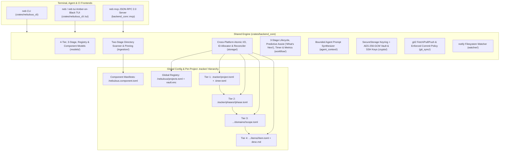

# Nebulous Architecture & 4-Tier `.tracker/` Schema

Nebulous is architected around a strict separation between **fast top-level indexes** (Tiers 1–3) and **authoritative atomic item storage** (Tier 4), backed by a shared cross-platform Rust library (`backend_core`) consumed by the `neb` CLI and retro Amber-on-Black TUI (`nebulous_cli`) as well as the `neb mcp` JSON-RPC 2.0 server.



---

## 1. Crate Responsibilities

### `crates/backend_core`
The foundational library crate with zero UI dependencies:
- **`models`**: Strongly typed Serde structs and enums for all 4 tiers (`ProjectManifest`, `PhaseManifest`, `ScopeManifest`, `ItemManifest`, `ItemDetail`, `ActiveTimer`), canonical 3-stage definitions (`CANONICAL_PHASES`: `pre_production`, `production`, `post_production`, `resolve_phase_alias`), `GlobalProjectRegistry` (`projects.toml`), and `ComponentManifest` (`nebulous.component.toml`).
- **`crypto`**:
  - **`SecureStorage`**: Cross-platform secret storage using native OS keyrings (`linux-native`, `apple-native`, `windows-native`) paired with an authenticated **AES-256-GCM encrypted file vault fallback** (`<config_dir>/nebulous/vault.enc`, `0600` Unix permissions, `Zeroize` memory scrubbing).
  - **`KeyPairManager`**: Generates, imports, retrieves, and deletes Ed25519 OpenSSH keypairs (`ssh-key`) and HTTPS Personal Access Tokens (PATs) per project/remote.
- **`ingestion`**:
  - **Two-Stage Directory Scanner**: Walks project directories using `ignore::WalkBuilder` (respecting `.gitignore` and skipping `.git/`, `.tracker/`, `target/`, `node_modules/`, `dist/`, `build/`, `__pycache__/`, `.venv/`).
  - Auto-detects ecosystem markers (`Cargo.toml`, `package.json`, `pyproject.toml`, `CMakeLists.txt`, `Makefile`, `Dockerfile`, `nebulous.component.toml`) and functional directories (`scripts/`, `iso/`, `config/`), recording normalized relative file paths (`files = [...]`).
  - Supports writing `nebulous.component.toml`, pinning `last_known_good` release snapshots (`pin_component_release`), rolling back (`rollback_component_to_pinned`), and promoting components into Tier 3 domain scopes mirrored across all stages (`promote_component_to_scope`).
- **`storage`**:
  - **`atomic`**: Write-to-temp-plus-rename (`<filename>.tmp.<pid>.<counter>`) with `File::sync_all()` and Windows-safe target replacement fallback so `.tracker/` files are never left half-written.
  - **`id`**: Monotonic ID allocation (`BUG-0001`, `FEAT-0001`) backed by `[counters]` in `project.toml` plus an on-disk high-water mark scan.
  - **`reconcile`**: Full tree walker (`TrackerStorage::reconcile_indexes`) that treats Tier 4 `item.toml` manifests as the single source of truth and rebuilds Tier 3 `scope.toml` stubs, Tier 2 `phase.toml` completion summaries, and Tier 1 `project.toml` counters.
- **`workflow`**:
  - **`lifecycle`**: Item creation, status transitions, automatic cross-stage scope mirroring (`ensure_scope_across_phases`), single-call item stage movement (`move_item_to_phase`), automated work start (`start_work_item`), closing/merging with automatic timer stop and commit SHA capture (`close_item`), and reopening with automatic `recurrence_count` and `iteration_count` increments (`reopen_item`).
  - **`assist`**: Predictive context and field inference (`infer_scope_from_context`, `resolve_active_or_inferred_item_id`, `predict_defaults`) and the ranked `"What's Next"` recommendation engine (`compute_whats_next`, `WhatsNextReport`, `NextRecommendation`, `NextActionKind`).
  - **`timer`**: Persistent session timer (`start_timer`, `stop_timer`, `timer_status`, `log_time`) stored in `.tracker/.timer.toml`.
  - **`metrics`**: Project-wide effort valuation (`target_daily_hours`), stagnant item detection (`stagnant_item_threshold_days`), item recurrence hotspots, and scope-level bug hotspot aggregation (`compute_metrics`).
- **`agent_context`**: Synthesizes `@file` reference tags and self-contained **Bounded Agent Prompts** (`export_agent_context`, `export_file_refs`, `export_bounded_prompt`) that constrain AI coding assistants to the scope's target directory and surface all prior fix attempts.
- **`git_sync`**: Native `git2` integration supporting explicit `git_fetch`, `git_pull`, `git_push`, and `git_commit_documented` enforcing `[git.commit_policy]`.
- **`mcp`**: Stateful JSON-RPC 2.0 `stdio` Model Context Protocol server (`McpServer`) supporting both line-delimited JSON and `Content-Length` framed transports.
- **`watcher`**: Recursive `notify` filesystem watcher (`TrackerWatcher`) that filters out read-only events and `.tmp.` sibling files and reconciles `.tracker/` indexes on external changes.

### `crates/nebulous_cli` (`neb` binary)
A CLI-first terminal and agent interface built with `clap`, `ratatui`, and `crossterm`:
- **CLI Subcommands & Zero-ID Shortcuts (`args.rs` & `commands/mod.rs`)**: Supports one-command `neb init`, zero-ID `neb start`, `neb done`, `neb show`, `neb context`, `neb move`, `neb stage`, and `neb next`, plus `--json` structured output across every subcommand.
- **Retro Amber-on-Black TUI (`tui/theme.rs`, `tui/state.rs`, `tui/render.rs`, `tui/mod.rs`)**:
  - **CRT Phosphor Palette (`theme.rs`)**: Enforces `BG_BLACK` (`#000000`), `PANEL_BG` (`#0C0800`), `AMBER_PRIMARY` (`#FFB000`), `AMBER_BRIGHT` (`#FFD866`), `AMBER_DIM` (`#996300`), `AMBER_DARK` (`#5C3A00`), and `AMBER_ALERT` (`#FF5500`).
  - **Aspect-Locked ASCII Nebula + `NEBULOUS` Header (`select_nebula_banner`)**: Selects between a `5×76` full block-letter banner (`width >= 78 && height >= 26`) and a `3×60` compact banner (`width < 78 || height < 26`), rendered centered (`Alignment::Center`) with wrapping disabled so the header never clips or deforms.
  - **Responsive Breakpoint Locks & Viewport Guard (`render.rs`)**: Enforces a 3-pane layout at `width >= 110`, a 2-pane + bottom inspector drawer layout at `64 <= width < 110`, and a non-deforming minimum-size scaling lock view below `64×20`. Modals use `locked_centered_rect`, dedicated row height locks (`Constraint::Length(3)`), horizontal cursor-window scrolling (`input_scroll_window`), and inline `[REQUIRED FIELD LOCK]` validation.

---

## 2. Global Config & 4-Tier `.tracker/` Directory Hierarchy

```text
<os_config_dir>/nebulous/                             # ~/.config/nebulous (Linux) | ~/Library/Application Support/nebulous (macOS) | %APPDATA%\nebulous (Windows)
├── projects.toml                                     # Global Multi-Project Registry
└── vault.enc                                         # AES-256-GCM encrypted credential vault fallback (0600)

<workspace_root>/
├── nebulous.component.toml                           # Optional root or per-subdirectory component & pin manifest
└── .tracker/
    ├── project.toml                                  # Tier 1: Global project manifest, counters, [components] & [git.commit_policy]
    ├── .timer.toml                                   # Ephemeral active session timer (when running)
    └── phases/
        ├── pre_production/                           # Stage 1: Planning & Design (mirrored scopes)
        │   ├── phase.toml
        │   └── domains/
        ├── production/                               # Stage 2: Active Implementation (mirrored scopes)
        │   ├── phase.toml                            # Tier 2: Stage manifest & scope registry
        │   └── domains/
        │       ├── inbox/
        │       │   ├── scope.toml                    # Tier 3: Default unscoped triage inbox
        │       │   └── items/
        │       └── backend_core/
        │           ├── scope.toml                    # Tier 3: Domain scope manifest, bound_component, tracked_files & item stubs
        │           └── items/
        │               ├── BUG-0001/
        │               │   ├── item.toml             # Tier 4: Authoritative item metadata & history
        │               │   └── desc.md               # Tier 4: Markdown specification & Fix Log
        │               └── FEAT-0001/
        │                   ├── item.toml
        │                   └── desc.md
        └── post_production/                          # Stage 3: Verification, Polish & Release (mirrored scopes)
            ├── phase.toml
            └── domains/
```
